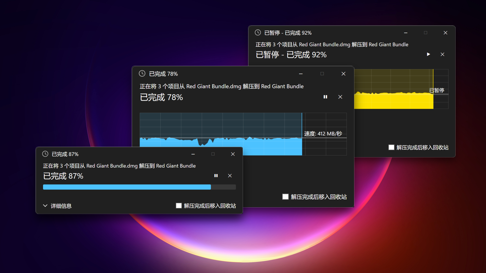
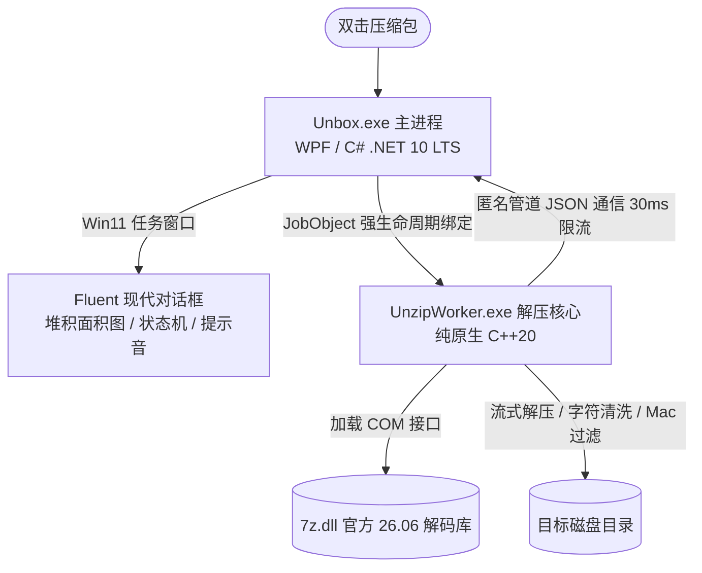

# Unbox

<h3>
  
  <i>Double-Click to Extract, Fluent & Native</i>
  
</h3>

**面向 Windows 11 的高仿原生文件复制对话框 · 极简无扰双击自动解压代理**

  
  
  
  
  
  

 

<!-- Hero Banner Showcase -->

  

<!-- Quick Navigation with Icons -->
<table>
  <tr>
    <td align="center" width="14%">
      <a href="#-the-problem">
         
        <b>痛点与初衷</b>
      </a>
    </td>
    <td align="center" width="14%">
      <a href="#-superpowers">
         
        <b>核心特性</b>
      </a>
    </td>
    <td align="center" width="14%">
      <a href="#-get-started">
         
        <b>快速上手</b>
      </a>
    </td>
    <td align="center" width="14%">
      <a href="#-supported-formats">
         
        <b>支持格式</b>
      </a>
    </td>
    <td align="center" width="14%">
      <a href="#-architecture">
         
        <b>架构设计</b>
      </a>
    </td>
    <td align="center" width="14%">
      <a href="#-roadmap">
         
        <b>路线规划</b>
      </a>
    </td>
    <td align="center" width="14%">
      <a href="#-license--credits">
         
        <b>开源与致谢</b>
      </a>
    </td>
  </tr>
</table>

 

---

## 💡 The Problem

<table>
<tr>
<td width="60%">

### 为什么在 Windows 上解压文件总是如此繁琐？

日常在 Windows 上解压文件，你一定经历过这样的场景：
- **菜单层级繁琐**：右键点击压缩包，在层层右键二级菜单里谨慎寻找“解压到当前文件夹”或“解压到 `包名\`”——一旦点错，上千个零散文件瞬间铺满整个桌面或下载文件夹；
- **弹窗与广告骚扰**：许多传统解压软件不仅体积臃肿、常驻后台，还充斥着弹窗推荐和捆绑应用；
- **解压向导打扰心流**：跳出一个复杂的解压向导窗口，反复确认目标路径、编码和压缩方式，解压完成后还要手动关闭窗口、找到对应文件夹。

> **Unbox 的回答：回归直觉。双击即可，解完即走。**

Unbox 让解压体验变得像 macOS 的 Archive Utility 一样自然，同时兼具 Windows 11 自带文件复制对话框的现代视觉质感。

</td>
<td width="40%" align="center">

 

**只需双击** 
无需选择菜单，无需确认路径 
后台流式解压，完成自动退出播放提示音

</td>
</tr>
</table>

 

---

## ⚡ Superpowers

### 六大精心设计的专业产品行为 (D1 ~ D6)

 

<table>
  <thead>
    <tr>
      <th width="30%">功能特性</th>
      <th width="70%">产品细节与行为规范</th>
    </tr>
  </thead>
  <tbody>
    <tr>
      <td>
        <b>🪟 1:1 原生 Win11 复制对话框</b> 
        Fluent 现代设计美感
      </td>
      <td>
        • <b>双模式自如切换</b>：默认保持极简折叠模式，一键展开详细监控； 
        • <b>平滑缓动动画</b>：展开与折叠采用 <code>CubicEase</code> 平滑过度，无生硬闪跳； 
        • <b>原生堆积面积图</b>：10x6 经典网格、水平吞吐波浪推进、500ms 平滑滤波限流；暂停时自适应转为琥珀金/亮黄色； 
        • <b>记忆偏好</b>：自动记住用户的展开/折叠状态，下次启动无缝还原。
      </td>
    </tr>
    <tr>
      <td>
        <b>📁 D1 目录结构与防冲突自增</b> 
        包内层级完整保留
      </td>
      <td>
        • <b>保留包内层级</b>：压缩包解压后统一以包名建立根目录（如 <code>测试.zip</code> 内有 <code>release/src/main.c</code>，解压后得到 <code>测试/release/src/main.c</code>）； 
        • <b>同名唯一根目录折叠</b>：仅当包内<strong>恰好只有一个子目录、无同级文件、且该子目录与压缩包基名一致</strong>时，才折叠这一级冗余同名目录（<code>希捷专修.zip</code> → <code>希捷专修/…</code>）。包名本身带 <code>(2)</code> 之类的后缀不会被误判； 
        • <b>复合扩展名智能剥离</b>：<code>.tar.gz</code>、<code>.tar.xz</code>、<code>.tgz</code> 按<strong>内容</strong>确认内层 TAR 后再展开，无原名、原名无扩展名的样本同样交付最终正文； 
        • <b>同名自动递增</b>：目标同级目录下若存在同名文件夹，自动递增命名为 <code>测试 (2)</code>、<code>测试 (3)</code>，<b>绝不覆盖已有文件</b>。
      </td>
    </tr>
    <tr>
      <td>
        <b>🗑️ D2 移入回收站与安全校验</b> 
        安全第一，源包无忧
      </td>
      <td>
        • <b>偏好持久化记忆</b>：界面勾选“解压完成后移入回收站”自动跨会话持久化保存； 
        • <b>分卷与无校验格式警示</b>：每次取消勾选后重新勾选时，贴心提示分卷包整组移入风险； 
        • <b>逐卷可验证的回收</b>：只回收本次真正读取过的源卷；回收前用<b>卷序列号 + 128 位文件 ID + 长度 + 修改时间</b>核对身份（被替换的文件拒绝回收），随后通过 Shell <code>IFileOperation</code> 显式回收，并<b>逐卷报告真实结果与回收站落点</b>； 
        • <b>安全兜底原则</b>：仅当全部交付内容通过<b>逐项清单对账</b>（路径/类型/长度，回收前追加 CRC32 摘要）时才回收源包；网络路径、不支持回收介质、中途取消、用户跳过条目或任一校验不一致时，<b>绝对保留源包</b>。按产品规则过滤的 macOS 元数据不计为跳过项。
      </td>
    </tr>
    <tr>
      <td>
        <b>🎯 D3 & D4 全面登记与镜像过滤</b> 
        专注归档，不破坏原生流
      </td>
      <td>
        • <b>全面关联 44+ 种格式</b>：涵盖所有主流归档、压缩流、分卷入口及常用虚拟机镜像； 
        • <b>智能排除系统原生容器</b>：严格排除资源管理器能原生挂载的镜像（<code>.iso</code>、<code>.vhd</code>、<code>.vhdx</code>）以及 Office/应用容器（<code>.docx</code>、<code>.apk</code>、<code>.msi</code>、<code>.exe</code>），保留原有启动与编辑入口。
      </td>
    </tr>
    <tr>
      <td>
        <b>🍏 D5 跨平台兼容 & Mac 辅助文件过滤</b> 
        告别乱码与苹果垃圾文件
      </td>
      <td>
        • <b>尊重归档声明的文件名编码</b>：ZIP 通用标志位（bit 11）声明为 UTF-8 的名称逐字保留，未声明编码的名称按系统代码页解码；仅当编码确实不确定时才弹出<b>编码选择框</b>（可选 UTF-8 / GBK / Big5 / Shift-JIS / EUC-KR 等，并附示例名）； 
        • <b>静默过滤苹果辅助文件</b>：解压时自动拦截并丢弃 <code>__MACOSX/</code> 目录、<code>.DS_Store</code> 及 <code>._*</code> 资源分叉文件，保持输出目录干净整洁；过滤项单独计数，不会导致正常文件被丢弃。
      </td>
    </tr>
    <tr>
      <td>
        <b>🛡️ D6 非法字符清洗与部分完成</b> 
        健壮容错，状态清晰
      </td>
      <td>
        • <b>非法字符自动清洗</b>：Windows 禁用字符（<code>:*?"<>|</code> 等）默认批量替换为 <code>-</code>，系统保留设备名（<code>CON</code>、<code>AUX</code> 等）自动加安全前缀； 
        • <b>跳过项联动规则</b>：若用户选择跳过非法条目，<b>可表示的文件仍会正常交付</b>，任务最终明确显示为“部分完成”，源压缩包自动保留，杜绝数据意外丢失；提取失败（CRC/数据损坏/缺卷）则整体不交付。
      </td>
    </tr>
  </tbody>
</table>

 

---

## 📦 Get Started

### 1. 下载便携包 (Portable)

直接在 [Releases](https://github.com/Snowa/Unbox/releases) 页面下载最新的 `Unbox-v1.2.0-win-x64.zip`。

- **免安装**：解压即可使用，支持随身 U 盘便携携带；
- **现代轻量化部署**：采用 **.NET 10 LTS 框架依赖部署 (Framework-Dependent)**，包体积仅 ~2.6 MB（缩减 95.3%）。系统仅需安装官方 Windows x64 .NET 10 桌面运行时 (Desktop Runtime)。

### 2. 一键注册关联

解压至您希望常驻的目录（如 `D:\Tools\Unbox`），然后：

1. 右键单击 **`注册关联.ps1`**，选择 **【使用 PowerShell 运行】**；
2. 脚本将通过系统原生注册表引擎，向 Windows 11 登记 **44 种文件格式** 的专用高清图标与 ProgID；
3. 随后脚本会自动为您打开 Windows 11 设置中的【默认应用】页面，确认设置即可！

### 3. 双击解压

关联完成后，直接在资源管理器中 **双击任意压缩包**：
- 现代任务窗口轻盈浮现，开始高速流式解压；
- 支持点击左下角 **“详细信息”** 查看实时吞吐面积图；
- 解压完成后播放专属提示音 `Finished.mp3` 并轻盈退出！

### 4. 彻底卸载与清理

若需完全取消文件关联，只需：
- 右键单击 **`取消关联.ps1`**，选择 **【使用 PowerShell 运行】**；
- 脚本将幂等清除全部写入系统的注册表 Capabilities、ProgID 项并广播刷新图标缓存，不留任何残留。

 

---

## 🗂️ Supported Formats

Unbox 完整覆盖了常见归档、流式压缩、分卷包以及发行镜像：

| 分类 | 格式扩展名 |
|:---|:---|
| **常用归档** | `.zip`, `.zipx`, `.7z`, `.rar`, `.r00`, `.tar`, `.ova` |
| **压缩流与复合别名** | `.gz`, `.gzip`, `.tgz`, `.tpz`, `.bz2`, `.bzip2`, `.tbz2`, `.tbz`, `.xz`, `.txz`, `.zst`, `.tzst`, `.lzma`, `.lzh`, `.lha`, `.z`, `.taz`, `.cab`, `.arj` |
| **分卷与发行包** | `.001` (分卷首卷), `.deb`, `.rpm`, `.cpio`, `.xar`, `.xip` |
| **映像与虚拟机磁盘** | `.wim`, `.swm`, `.esd`, `.dmg` (Apple 磁盘映像), `.squashfs`, `.vmdk`, `.vdi`, `.qcow`, `.qcow2`, `.fat`, `.ntfs` |

> *注：系统原生可直接加载挂载的 `.iso`、`.vhd`、`.vhdx` 以及办公文档容器（`.docx`、`.xlsx` 等）严格排除关联，保留原有系统行为。*

 

---

## 🛠️ Architecture

Unbox 采用现代客户端软件的典型**进程隔离双核心架构**：

- **前端交互（Unbox.exe）**：
  基于 WPF 与 .NET 10 LTS，深度融合 Windows 11 DWM 圆角渲染与深色模式 API。面积图采用高性能分桶推进算法，速度指标经过 500ms EMA 滤波与 30ms 管道限流，UI 帧率极度丝滑；
- **原生后端（UnzipWorker.exe）**：
  纯原生 C++20 编写，加载官方 `7z.dll` COM 解码接口。依托 Windows `JobObject` 保证主窗口关闭时工作进程 100% 级联终结，绝不发生后台孤儿进程泄漏。

 

---

## ✅ Quality & Verification

- **发布组件可独立复核**：`dist/Unbox-v1.2.0-win-x64.zip` 的 SHA-256 与测试所用组件记录在 `HANDOFF.md`；包内 `构建信息.txt` 记录 Git 提交号与 `Unbox.exe` / `UnzipWorker.exe` / `7z.dll` 的 SHA-256。
- **生产完成路径自动化**：`tests/Tester` 直接调用与 WPF 完全相同的 `ExtractionCompleter`（清单对账 → 同名折叠 → 来源标记 → 单次目录改名提交 → 提交后复核 → 逐卷回收），82 项用例覆盖文件名编码、复合 TAR、缺尾卷、空归档、部分完成、回收身份核对，以及真实回收后从回收站落点核对 SHA-256。
- **性能基线**（同机实测）：1,200 个小文件解压 `373 ms` / 13 个进度帧；清单对账 + 单次目录改名提交 `109 ms`。

 

---

## 🗺️ Roadmap

Unbox 持续演进中，后续版本规划如下：

- [ ] **多国语言国际化 (i18n)**：添加多国语言支持，根据 Windows 系统语言自动选择并切换默认显示语言；
- [ ] **Windows 11 原生风格归档管理器 (Unbox File Manager)**：提供完整查看、修改、打包压缩包内容的高级文件管理界面，基于 Windows 11 原生 Fluent 风格重新打造类似 7zFM 的现代体验；用户通过**按住 Shift 键双击压缩文件**即可呼出文件管理窗口，兼顾轻量极速解压与深度包内浏览修改的双重需求。

 

---

## 📜 License & Credits

 

### Standing on the Shoulders of Giants

- **解压核心引擎**：[7-Zip 26.06 (x64)](https://www.7-zip.org/) by Igor Pavlov（遵循 GNU LGPL 协议）；
- **图标原始设计**：[smalllikeart (Flaticon)](https://www.flaticon.com/authors/smalllikeart) 并由本项目根据格式定制生成；
- **Emoji 资源**：[Animated Fluent Emojis](https://github.com/Tarikul-Islam-Anik/Animated-Fluent-Emojis) by Tarikul Islam Anik。

本项目开源核心采用 [MIT License](LICENSE)。

---

Made with ❤️ for Windows 11 Users

 

